# Farhan Ali · Software Development Portfolio

I build mobile apps, web tools, and backend services. My commercial work spans more than four years and includes investment wallets, payment and banking integrations, recurring donations, delivery workflows, and app releases.

[Email](mailto:farhanalidev1@gmail.com) · [LinkedIn](https://www.linkedin.com/in/farhan-ali-64a254209/)

[Live projects](#live-projects) · [Runnable projects](#runnable-projects) · [Production work](#selected-production-work) · [Interface concepts](#interface-concepts) · [AI systems](#ai-systems) · [Machine learning](#machine-learning) · [Data science](#data-science)

## Live projects

| Project | Explore |
| --- | --- |
| **RetailDesk** | Inventory, checkout, and daily shop operations. [Open RetailDesk](https://retail-desk-pk.netlify.app/) |
| **Vaulta** | Product site for a cross-platform download manager. [Open Vaulta](https://nomixee.github.io/vaulta/) |

## Runnable projects

Each project has setup instructions, sample data, and verification steps.

| Project | Stack | What to try |
| --- | --- | --- |
| [**Grant Desk**](projects/grant-cms/) | Node.js, JavaScript, HTML/CSS | Import a legacy grant, review a draft, publish it, and follow the old URL to the new page. |
| [**Crescent Ledger**](projects/investment-wallet/) | Flutter, Dart | Add demo cash, allocate it across holdings, and reconcile balances against activity. |
| [**Giving Ops**](projects/giving-ops/) | TypeScript, Node.js, SQLite | Run recurring donation jobs, simulate a gateway failure, and rerun the scheduler without a duplicate charge. |
| [**Dispatch Desk**](projects/dispatch-ops/) | Python, SQLite, HTML/CSS | Assign a delivery, record the pickup, and confirm delivery with a recipient code. |
| [**Transaction Review Lab**](projects/transaction-review/) | Python, NumPy, scikit-learn | Train a review model, evaluate it on a later data window, and inspect one score's feature contributions. |
| [**Harborline Help Desk**](projects/support-assistant/) | Python, BM25, extractive question answering | Ask a product question, check the cited documentation, and see how the assistant handles an unsupported question. |

The runnable projects are portfolio implementations with fictional data. The production case studies describe my contributions to the original products.

## Project previews

<a href="projects/giving-ops/">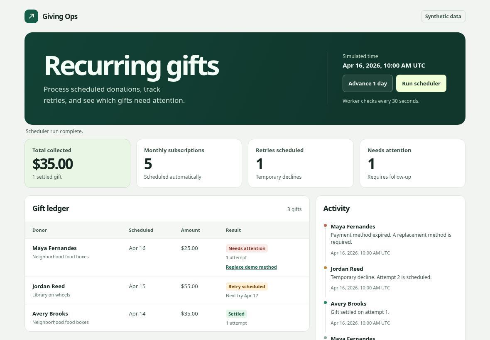</a>

## Selected production work

- **Sukuk Capital.** Led investment app architecture and development, including wallet and portfolio modules, PayFort and custodian bank integrations, and the mobile release pipeline. [iOS](https://apps.apple.com/us/app/id1664435903) · [Android](https://play.google.com/store/apps/details?id=com.sukuk.live)
- **Bespokely.** Built reusable mobile components and configurable features, and integrated application APIs and payment services for a hospitality product. [Product site](https://bespokely.io/)
- **Entertainment.** Maintained digital offers and coupon features, with testing and reliability fixes across updates. [Android](https://play.google.com/store/apps/details?id=com.entertainmentbook.aus) · [iOS](https://apps.apple.com/au/app/entertainment-play-dine-save/id840550967)
- **Kynami.** Developed donation and recurring subscription flows and implemented scheduled backend processing in Node.js and TypeScript.

[Read the engineering case studies](docs/case-studies.md)

## Interface concepts

These desktop and iPhone mockups use sample data.

### Agent Control Room

**Interface concept · Proposed**

An operations reviewer would select a run in the Mac dashboard and see its current step, owner, and execution status. The approval queue would surface runs waiting on a person. Selecting one would bring the proposed action, its destination, and the relevant evidence into the run detail.

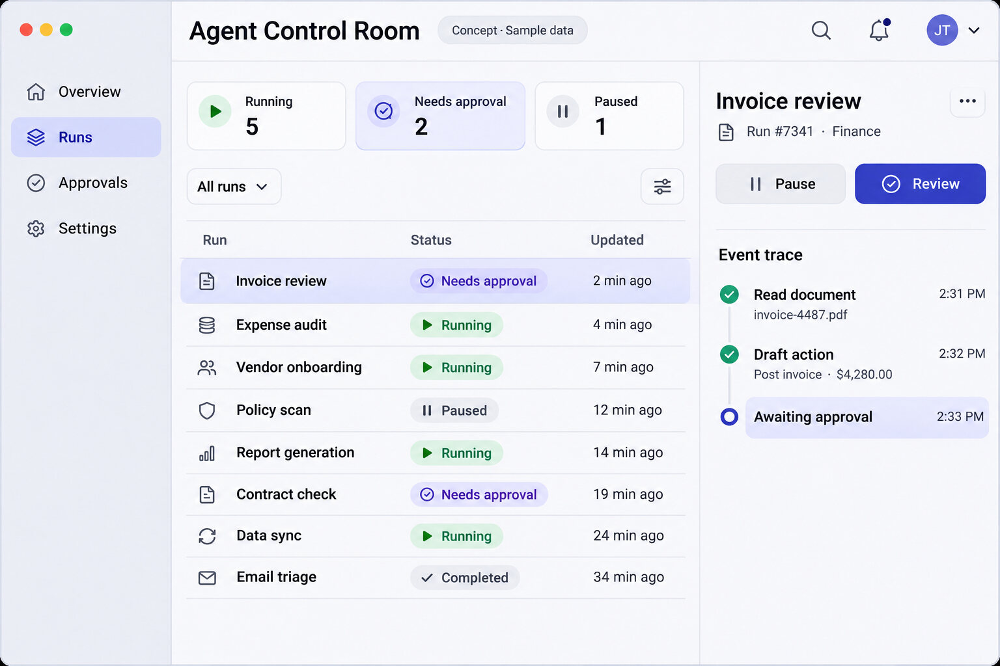

Read the concept notes

The event trace would show what the agent read, which tools it called, and where it paused. Pending, running, paused, and completed steps would have distinct text states. A reviewer could pause a run or approve the specific pending action from the detail view.

Approval would apply only to the displayed action and parameters. Changes to either would require fresh approval. The event trace would record the reviewer’s decision and timestamp. All run records shown in the mockup are synthetic.

### Distributed Systems Dashboard

**Interface concept · Proposed**

An on-call engineer would start with the service topology and select a node to see its dependencies, latency, and error rate in the selected time window. The SLO panel would pair the reliability target with the error budget remaining, giving context for a change in service health.

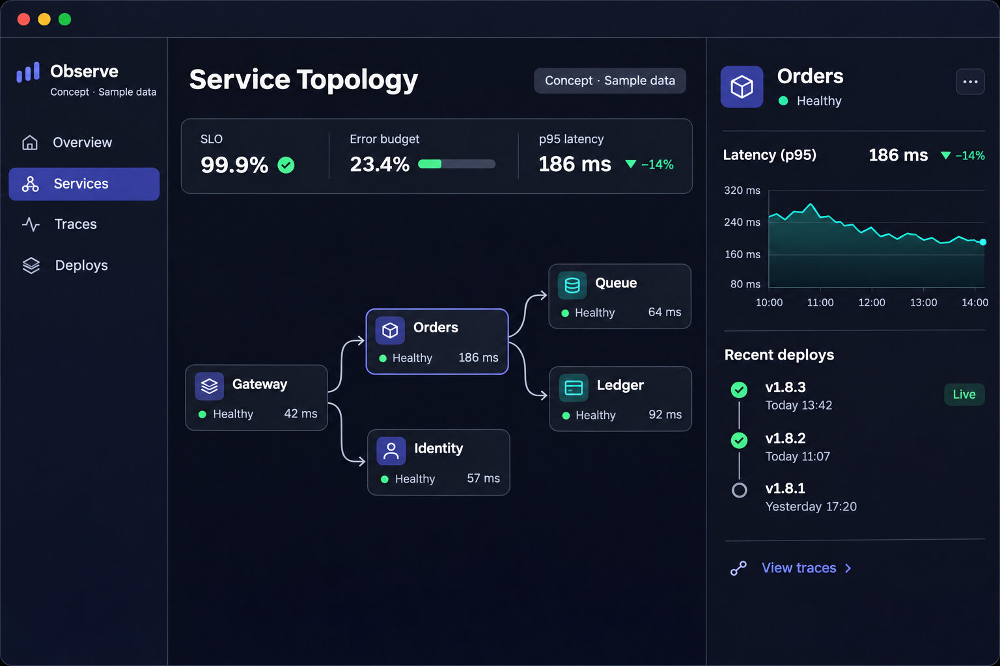

Read the concept notes

Deploy events would share a timeline with latency and errors. Selecting a deploy would narrow the window around the release. The engineer could drill into a representative trace to see which service or dependency contributed to a slow request.

This would be a read-only console. Missing or delayed telemetry would be marked explicitly in the affected panel, and traces would omit sampled payload content. A nearby deploy would be shown as evidence to investigate. The topology and telemetry in the mockup are synthetic.

### Investment Portfolio

**Interface concept · Proposed**

The iPhone home screen would show the sample portfolio’s USD value above a performance chart. Available cash and invested value would appear separately, with an allocation breakdown to make concentration visible. Changing the chart range would update the dates and return period together.

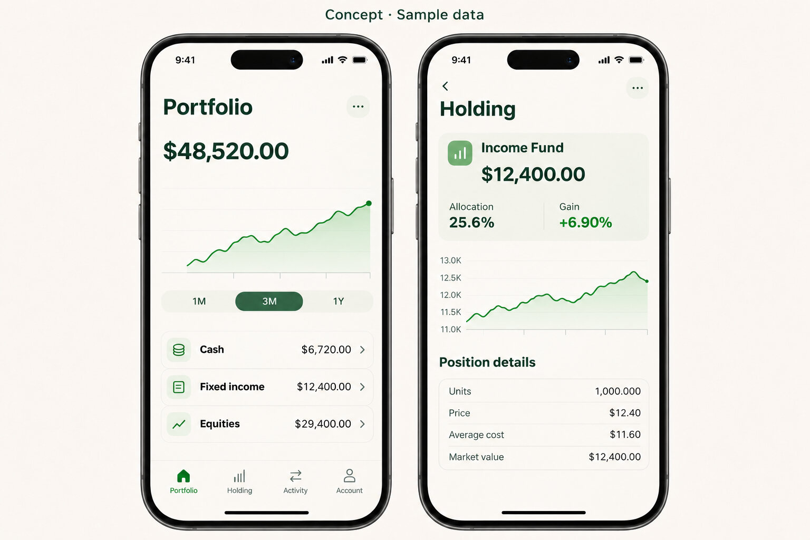

Read the concept notes

Tapping a holding would open its detail, with the position’s value, cost basis, portfolio share, and recent performance. The user could compare an overall gain with the gains or losses on individual holdings and return to the same portfolio view.

A loss would carry a minus sign and a written label so its meaning survives a change in color perception. The chart’s end date and valuation timestamp would stay visible. All prices, returns, and cash balances are simulated. This concept covers viewing and reviewing a portfolio.

### User Access Dashboard

**Interface concept · Proposed**

A workspace administrator would use the Mac dashboard to find a team member, check their role and access status, and open their recent access history. The dashboard would show which users authenticate through SSO, whether the provider is connected, and which invitations are still pending.

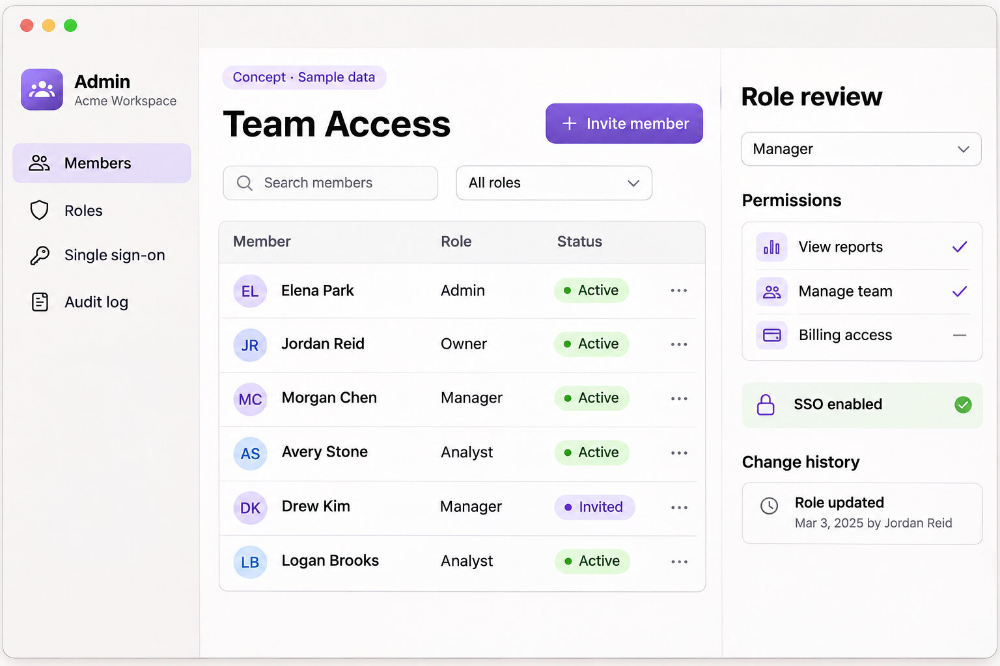

Read the concept notes

To invite a colleague, the administrator would select a role and scope. A review step would show the effective permissions before the invitation is sent. For an existing member, the same view would show what changes when their role is edited, including any newly granted admin privileges.

Access updates would require explicit confirmation. The audit panel would record the actor, affected account, old and new roles, and timestamp. Reviewers with read-only privileges could inspect the history. The accounts and identity-provider states in the mockup are fictional.

## AI, ML, and data science proposals

Each proposed project includes a workflow diagram, a data plan, and an evaluation plan.

### AI systems

#### Policy and Procedure Q&A

**Project brief · Proposed**

An internal help desk loses time answering routine questions about travel approvals, purchase limits, and reimbursements. A policy assistant would point staff to the relevant rule and its effective date, then route exceptions to the policy owner.

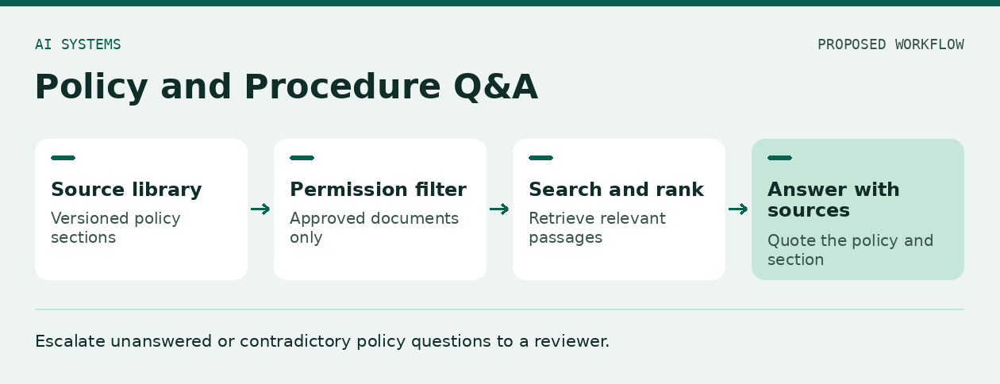

Read the full project brief

**Data and provenance**

Start with an original handbook for a fictional organization. Create dated editions, section IDs, and an owner for each policy. Write deliberate edge cases, including different rules by location, a policy that supersedes an older edition, and a procedure referenced by two policies. Store each document's source, approval status, effective date, and access group alongside the text.

**Proposed approach**

Index the handbook by section and combine keyword and semantic retrieval. Constrain retrieval by the reader's access group, location, and applicable date before ranking passages and assembling a response. Each answer would cite the document title, section, and version and show the passage used. When sources conflict, an important fact is missing, or matches are weak, the assistant would ask for clarification or refer the question to the policy owner. Approval decisions stay with staff.

**Evaluation**

Create a held-out set covering routine lookups, paraphrases, prior dates, conflicting rules, and requests for restricted material. Have a reviewer label the expected section, version, and escalation outcome. Compare cited-answer accuracy and correct escalations against keyword search. Test that changing a reader's access group removes restricted passages from results and citations.

**First deliverable**

A searchable synthetic handbook, a browser prototype with expandable citations, and a repeatable evaluation set with reviewer labels.

#### Visual Inspection for Returns

**Project brief · Proposed**

Returns reviewers often get several photos per item with inconsistent lighting and coverage. This proposal explores whether a review tool could identify visible damage and save reviewers time by pointing them to the image and region that merit attention.

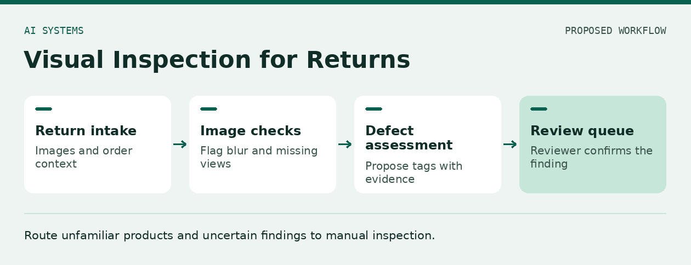

Read the full project brief

**Data and provenance**

Start with an original photo set of staged returns using unbranded sample items. Photograph intact items, crushed boxes, broken seals, and cosmetic scratches under varied lighting and camera angles. Record which item, session, and capture conditions produced each image. Two reviewers would label defect type and visible location independently. Keep disagreements as examples of uncertainty and remove shipment labels or identifying details before indexing images.

**Proposed workflow**

Check each submission for blur and required views. A vision model would propose a defect category and show its supporting region alongside the original photo. A review queue would surface missing views, low-confidence predictions, and disagreement between images of the same item. Reviewers would confirm or correct proposed observations and make the final return decision.

**Evaluation**

Hold out physical items and photo sessions to avoid testing on near duplicates. Compare the model with a checklist-only workflow. Measure missed visible damage, false flags on intact goods, and reviewer time per case. Report results separately by defect type and photo quality, and examine how accuracy changes as more cases are routed for manual review.

**First deliverable**

A local review prototype with a labeled sample batch, a side-by-side photo and evidence view, and a rubric for comparing decisions on held-out returns.

#### Incident Triage Copilot

**Project brief · Proposed**

When checkout latency spikes during an on-call shift, responders need to identify which services and customers are affected. This copilot would assemble the evidence into a timeline and suggest where the responder should start looking.

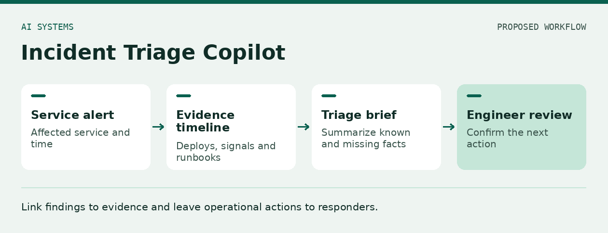

Read the full project brief

**Data and provenance**

Create a fictional storefront and generate timestamped alerts, service metrics, application logs, and release events. Each scenario would have an authored incident timeline, expected responding team, and synthetic runbook. Include duplicate alerts, delayed telemetry, routine deployments, and scenarios with incomplete evidence. Use generated identifiers and fixed random seeds so reviewers can reproduce each case.

**Proposed approach**

Group alerts by service, environment, and time window, then attach nearby releases and observable changes in error rate, traffic, or latency. Retrieve the relevant runbook and generate a short triage note that links each observed fact to an event. Show uncertainty when the data supports several explanations. Responders would confirm incident severity, routing, and next actions. The prototype would accept read-only event inputs.

**Evaluation**

Hold out entire incident scenarios so alert variants from one scenario stay together. Compare a threshold-only baseline and the copilot on alert grouping, routing accuracy, and how often a reported fact can be verified from its links. Time reviewers as they identify the affected service in each interface. Count false escalations on routine activity and check whether sparse data triggers review.

**First deliverable**

A deterministic replay of scripted incidents, a browser view linking each triage note to evidence, and a labeled evaluation worksheet for reviewers.

#### Multilingual Voice Intake

**Project brief · Proposed**

People opening a support request by voice may switch languages mid-sentence or spell a reference number over a noisy connection. This proposal explores turning those recordings into editable ticket drafts while preserving the original request and surfacing uncertain details.

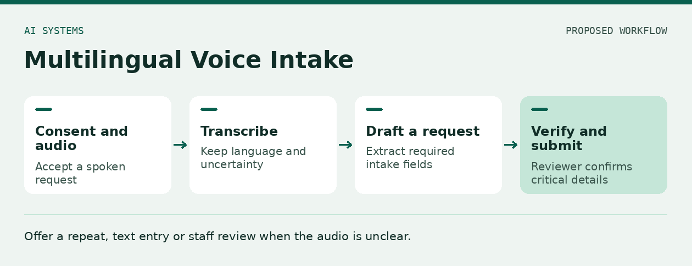

Read the full project brief

**Data and provenance**

Write fictional support scenarios in English and Urdu, including mixed-language calls. Record the scripts with consenting speakers and log language, recording conditions, and permission to use each clip. Use invented names, contact details, and reference numbers. Pair each recording with a reviewed transcript and a manually labeled ticket so speech and field extraction can be evaluated separately.

**Proposed workflow**

Transcribe the recording with timestamps, then extract a short description, request category, callback preference, and any reference number into a draft. Keep the original transcript next to the structured fields and link each field to its evidence in the conversation. Flag ambiguous language, missing required fields, and uncertain names or numbers for review. A reviewer can replay the relevant audio, correct the draft, and approve it before submission.

**Evaluation**

Hold out speakers and scripts, and report results by language, code-switching, and background noise. Measure transcription error alongside field accuracy, with exact matching for reference numbers. Track how often the reviewer catches an incorrect field and how long it takes to prepare a ticket compared with manual intake.

**First deliverable**

A local intake prototype with staged recordings, timestamped transcript and draft review, and a benchmark set for English, Urdu, and mixed-language clips.

### Machine learning

#### Delivery ETA with Prediction Intervals

**Project brief · Proposed**

A dispatch team needs to know when a delivery is likely to arrive and how much room to leave for delays. This project would estimate delivery time at assignment and show an interval that helps operators decide when to follow up.

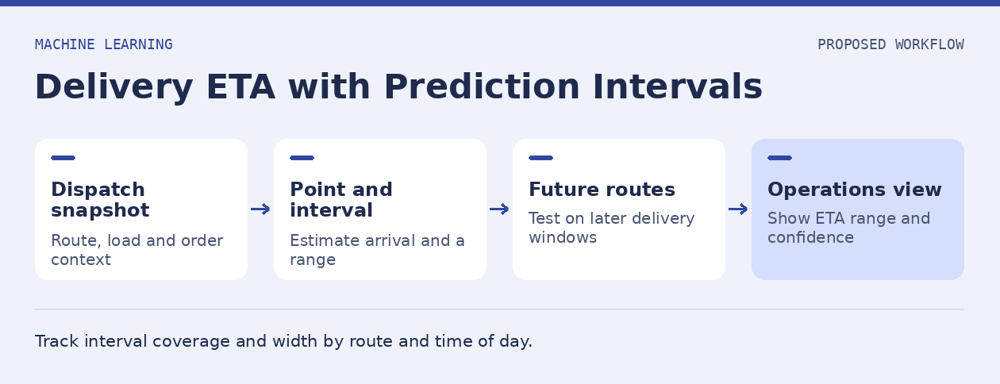

Read the full project brief

**Data and provenance**

Generate synthetic delivery assignments across several fictional zones. Each record would include the assignment timestamp, origin and destination zones, estimated route length, and the number of active deliveries at assignment. Simulate arrival times with separate travel and handoff delays, including busier periods and occasional disruptions. Document the generator version, random seeds, feature availability, and label definition. Keep the realized travel and handoff times for evaluation and error analysis.

**Proposed approach**

Start with historical median delivery time by distance band and hour, backed by the overall median for sparse groups. Use empirical lower and upper quantiles for the baseline interval. Compare it with gradient-boosted quantile regressors that predict the median and the bounds of an 80% interval. Use a later calibration window to adjust the bounds with split conformal calibration.

**Evaluation**

Train, calibrate, and test on consecutive time blocks. Build each feature using records available at the assignment timestamp. Compare median absolute error, interval coverage, and average width against the baseline. Break out results by route length and peak load, and report how often the lower or upper bound misses. Use a final disruption scenario to check how the interval behaves when conditions shift.

**First deliverable**

A versioned synthetic dataset, a reproducible evaluation, and a small dispatch view showing the estimated arrival, interval, and assignment-time inputs.

#### Nearby Offers Recommender

**Project brief · Proposed**

A neighborhood offers app needs to surface promotions people can actually use. The first version would rank active offers within a chosen radius and balance proximity with relevance, including for someone who has just opened the app.

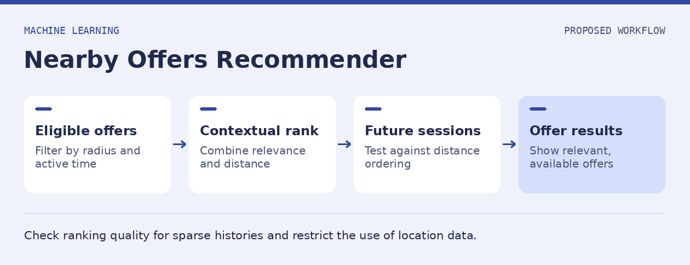

Read the full project brief

**Data and provenance**

Create a synthetic catalog of venues, locations, categories, discounts, opening hours, and offer validity periods. Generate fictional sessions that contain a coarse location, optional category preference, and prior interactions. A separate simulator would generate clicks and saves from hidden preferences, convenience, and random variation. Log impressions and their order, and publish the generation rules, seeds, and offer snapshots used in evaluation.

**Proposed approach**

Filter by distance, availability, and any user-selected category before ranking. Start with a distance-first baseline, breaking ties by offer expiry. Compare it with a lightweight ranker using distance, category match, offer value, and prior category interactions. For sessions with no history, fall back to contextual features and record the reason for each top recommendation.

**Evaluation**

Split sessions chronologically and reconstruct offer eligibility at the exact request time. Compute interaction counts using earlier events only. Use randomized impressions in the synthetic test set to reduce position bias. Report NDCG@5 and Recall@5 on judged candidates, show results for new and returning users separately, and check that expired or out-of-radius offers never appear. Report category coverage alongside ranking quality.

**First deliverable**

A generated offer catalog, a reproducible comparison against the distance baseline, and a browser mock-up that shows how changing location or category affects eligible offers.

#### Inventory Demand Forecasting

**Project brief · Proposed**

A small retailer needs a short list of products to reorder before the next delivery. This project would produce seven-day sales forecasts and show where uncertainty can change a replenishment decision.

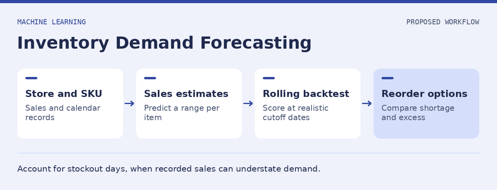

Read the full project brief

**Data and provenance**

Use a documented slice of the public M5 Forecasting data. Select about 30 item-store series using a minimum history requirement from the first training window. Use daily unit sales and calendar attributes. Treat the target as observed sales, which can be lower than demand during stockouts. Use a separate synthetic inventory scenario with known on-hand quantities, restock dates, and lead times to explore that difference. [M5 data](https://www.kaggle.com/competitions/m5-forecasting-accuracy/data)

**Proposed approach**

Establish a seasonal baseline by repeating the previous week's sales. Compare it with a pooled gradient-boosted model that estimates median and upper-quantile sales for the full seven-day horizon. Use lagged sales, prior rolling summaries, item identifiers, and known calendar events. Apply an explicit lead-time assumption when translating a forecast and current stock into a proposed reorder quantity.

**Evaluation**

Use rolling weekly cutoffs, training on targets whose entire seven-day window ends before each cutoff. Rebuild history features for each forecast. Report mean absolute error on weekly totals, upper-quantile loss, and coverage across fast- and slow-selling items. In the synthetic reorder simulation, compare unfilled units and average stock under the same lead-time and ordering policy.

**First deliverable**

A repeatable backtest, a forecast table with error and coverage by item segment, and an illustrative reorder list for the synthetic inventory scenario.

#### On-Device Content Classification

**Project brief · Proposed**

A mobile reading app needs a topic label for short English articles so readers can filter saved items offline. The first version would classify a title and short description as world news, sports, business, or science and technology, with an option to leave uncertain items unclassified.

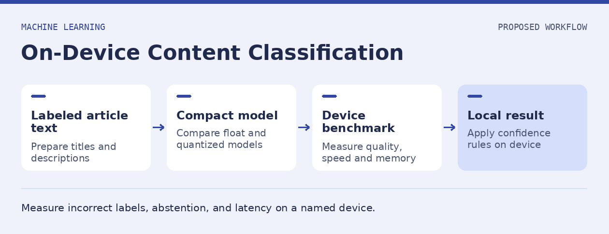

Read the full project brief

**Data and provenance**

Use the public AG News classification dataset, which provides labeled headlines and descriptions across four topics. Record the dataset revision and normalization rules. Add a separate synthetic challenge set with short titles, missing descriptions, spelling mistakes, and topics outside the four supported classes. Preserve its generation rules and label guidelines so the evaluation can be repeated. [AG News dataset card](https://huggingface.co/datasets/fancyzhx/ag_news)

**Proposed approach**

Start with a word and character n-gram logistic regression baseline. Compare it with a small text convolutional model converted to an integer-quantized mobile format. Package the tokenizer and model together, set a fixed input limit, and tune an abstention threshold on validation data. The proposed app would run inference locally and let the reader change a suggested label.

**Evaluation**

Keep the official test split held out. Apply a fixed text similarity rule to remove training articles that duplicate test articles, then fit preprocessing and model parameters on training data. Report macro F1, per-topic recall, errors among accepted predictions, and the fraction classified at the chosen threshold. On a reference Android phone, record the device model, package size, peak memory, and cold and warm end-to-end latency. Report challenge set behavior separately.

**First deliverable**

An offline evaluation report, a device benchmark plan, and a prototype screen showing the predicted topic and manual override.

### Data science

#### Feature Rollout Experiment

**Project brief · Proposed**

Evaluate whether an optional setup checklist helps new accounts complete their first meaningful action within seven days. The decision is whether to release the checklist broadly, revise it, or leave the current setup flow in place.

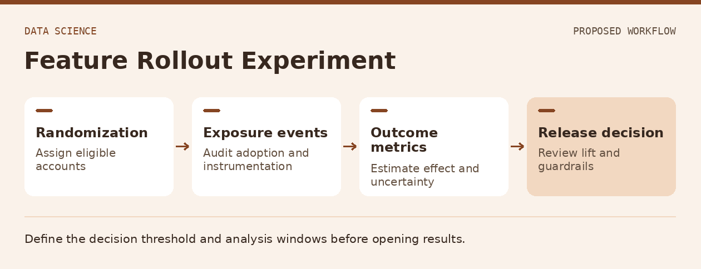

Read the full project brief

**Data and design**

Use generated event logs for a reproducible example. A real analysis would require authorized, pseudonymized account creation, random assignment, exposure, setup, and core-action events. Specify the core action and eligible account population before enrollment. Record the assignment timestamp and product version so retries and reassignments can be detected. Exclude internal and test accounts using rules set before randomization.

Assign eligible accounts equally to the current flow and the checklist. Keep the assignment stable for each account. Estimate the seven-day activation difference across all assigned accounts, including those that never see the checklist. Define the smallest worthwhile lift and the stopping rule before looking at outcomes. Monitor setup abandonment and error rates as guardrails.

**Validation and decision artifact**

Check the assignment split, event ordering, unique exposure counts, and completeness of follow-up. Investigate missing events or account-level contamination before interpreting outcomes. Show confidence intervals and check whether conclusions change under plausible missing-event assumptions. Treat platform and acquisition-channel breakdowns as exploratory unless they were specified and powered in advance.

The first deliverable would be a one-page launch memo with the activation estimate, uncertainty, guardrails, and a decision rule. A broad rollout would require evidence of a worthwhile lift and acceptable guardrail performance. Inconclusive evidence would call for another test or a revised checklist.

#### Subscription Cohort and Revenue Analysis

**Project brief · Proposed**

Determine whether a subscription business should prioritize onboarding improvements or failed-payment recovery. The first analysis would locate where paying subscribers leave and how those losses contribute to changes in recurring revenue.

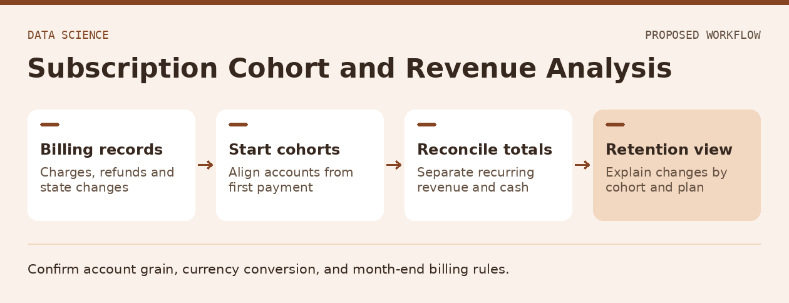

Read the full project brief

**Data and measures**

Start with a generated billing dataset spanning 18 monthly cohorts and two plan intervals. For a real study, use a permissioned billing export with pseudonymous customer IDs, invoices, plan changes, cancellation reasons, payment attempts, refunds, and reactivations. Use one reporting currency or document conversion rates. Preserve both event time and ingestion time so late events can be reconciled.

Group subscribers by first successful paid invoice. Calculate retention at each completed month of tenure, with a separate view for account and recurring-revenue retention. Convert annual plans to monthly equivalents for recurring revenue while keeping cash receipts separate. Build a monthly revenue bridge for new subscriptions, upgrades, downgrades, churn, and reactivation. Separate voluntary cancellations from terminal payment failures and leave ambiguous cases in an unknown category.

**Validation and decision artifact**

Reconcile revenue totals to the export, then review representative accounts with pauses, mid-cycle changes, refunds, or duplicate events. Mark cohorts without enough follow-up. Compare like-for-like tenure across plan intervals and rerun the analysis with an alternative payment grace period to test whether the prioritization changes. Use customer-level uncertainty estimates where cohort sizes allow.

The first deliverable would be an annotated cohort table and revenue bridge with revenue lost after unresolved payment failures shown separately from early voluntary churn. The review would choose one intervention to test and define the metric that would justify expanding it.

#### Transit Accessibility Analysis

**Project brief · Proposed**

Compare an earlier first-bus departure with a timed transfer for people traveling to primary care clinics. The decision is which timetable change warrants a pilot in a single corridor.

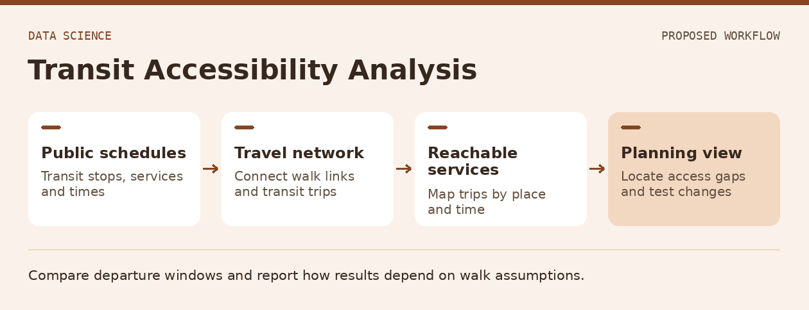

Read the full project brief

**Data and measures**

Select one city with a publicly available General Transit Feed Specification schedule and a municipal clinic registry. Record each source, license, download date, and service calendar. Use open street-network data for walking access and published small-area population counts to weight origins. Represent origins as grid cells or census centroids with aggregate counts. Patient addresses and trip histories are outside the scope.

Build a baseline for weekday mornings that includes walking, initial wait, scheduled travel, and transfers. Measure the share of residents within a 45-minute trip to at least one clinic open at arrival. Compare the two scenarios at fixed departure times, such as every 15 minutes between 7 and 9 a.m. Report the population gaining or losing access and the change in vehicle service minutes for each scenario.

**Validation and decision artifact**

Check a sample of baseline trips against published timetables, including a missed connection, a walking-only trip, and a route with no early service. Vary walking speed, transfer buffers, and departure times to see whether the preferred scenario changes. Distinguish scheduled reachability from real-world reliability. If historical delay data are available, use them to test how often the timed transfer would hold.

The first deliverable would be a paired accessibility map and a corridor-level table. It would highlight where each option helps, any areas losing service, and the operating assumptions planners would need to confirm before a pilot.

#### Marketplace Liquidity Analysis

**Project brief · Proposed**

Identify whether a local services marketplace should recruit more providers, change how it matches requests, or improve booking follow-through. The proposed study focuses on one service category across three zones and looks for the point where viable requests stop converting.

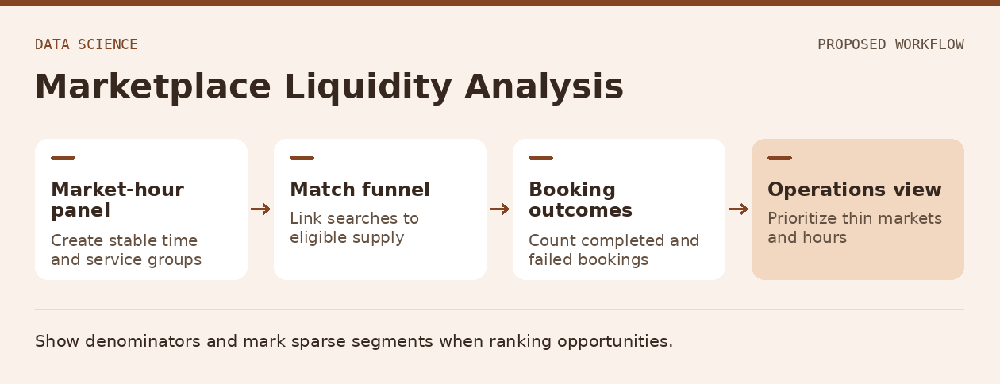

Read the full project brief

**Data and measures**

Create synthetic requests, provider schedules, eligibility rules, offers, responses, and bookings for the first demonstration. A real analysis would need approved event exports with pseudonymous request and provider IDs, coarse zones, service categories, and timestamps. Measure provider availability from schedule snapshots recorded before each request. That preserves what the marketplace knew when it tried to make a match.

Use eligible requests as the main denominator. Deduplicate retries and identify rescheduled bookings using explicit event rules. For each zone and request hour, estimate the shares with an available qualified provider, a response from an eligible provider within 24 hours, and a completed booking within seven days. Separate customer cancellations from provider declines. Use time to first response and provider workload to check whether a faster process would concentrate work on a few providers.

**Validation and decision artifact**

Reconcile event counts to bookings and inspect samples of requests with no match, multiple offers, or a cancellation. Exclude recent requests that cannot yet complete the measurement window. Compare weekdays with weekends, check sensitivity to zone boundaries and response windows, and suppress cells with too few requests. Treat observed differences as diagnostic evidence and test an intervention before attributing an improvement to it.

The first deliverable would be a zone-by-hour table with funnel counts and uncertainty. It would identify one constraint to test and a metric for judging the response.

