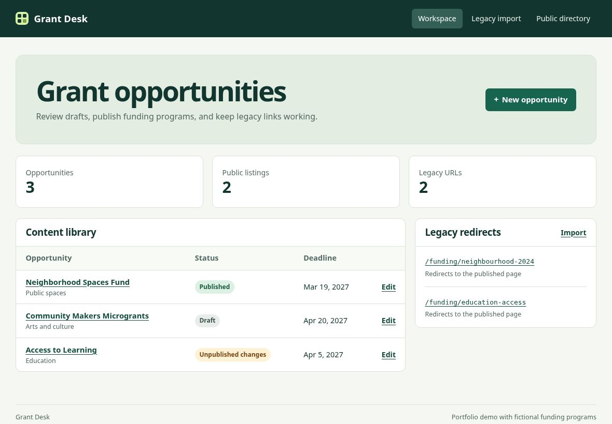
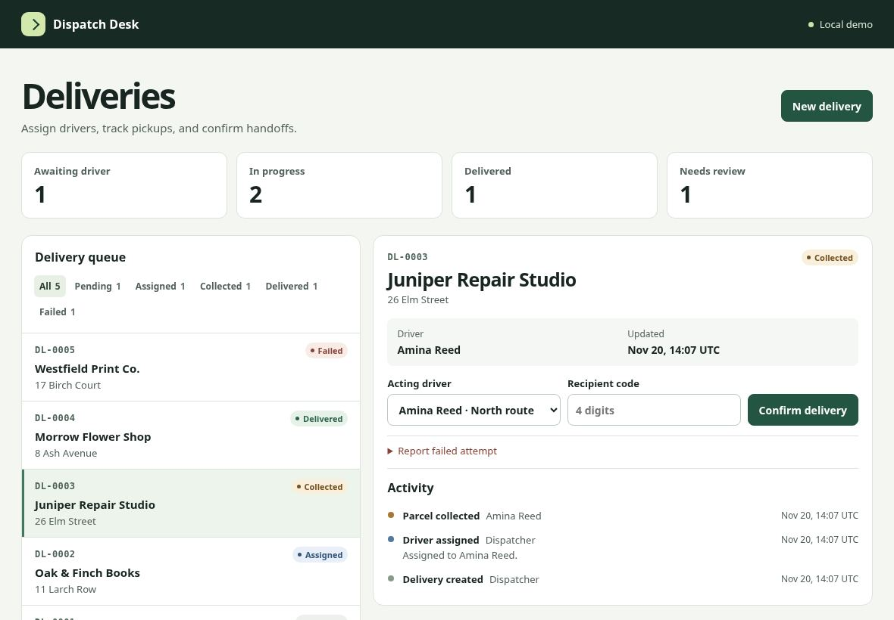

# Farhan Ali · Software Development Portfolio

I build mobile apps, web tools, and backend services. My commercial work spans more than four years and includes investment wallets, payment and banking integrations, recurring donations, delivery workflows, and app releases.

[Email](mailto:farhanalidev1@gmail.com) · [LinkedIn](https://www.linkedin.com/in/farhan-ali-64a254209/)

## Live projects

| Project | Explore |
| --- | --- |
| **RetailDesk** | Inventory, checkout, and daily shop operations. [Open RetailDesk](https://retail-desk-pk.netlify.app/) |
| **Vaulta** | Product site for a cross-platform download manager. [Open Vaulta](https://nomixee.github.io/vaulta/) |

## Runnable projects

Each project has setup instructions, sample data, and verification steps.

| Project | Stack | What to try |
| --- | --- | --- |
| [**Grant Desk**](projects/grant-cms/) | Node.js, JavaScript, HTML/CSS | Import a legacy grant, review a draft, publish it, and follow the old URL to the new page. |
| [**Crescent Ledger**](projects/investment-wallet/) | Flutter, Dart | Add demo cash, allocate it across holdings, and reconcile balances against activity. |
| [**Giving Ops**](projects/giving-ops/) | TypeScript, Node.js, SQLite | Run recurring donation jobs, simulate a gateway failure, and rerun the scheduler without a duplicate charge. |
| [**Dispatch Desk**](projects/dispatch-ops/) | Python, SQLite, HTML/CSS | Assign a delivery, record the pickup, and confirm delivery with a recipient code. |
| [**Transaction Review Lab**](projects/transaction-review/) | Python, NumPy, scikit-learn | Train a review model, evaluate it on a later data window, and inspect one score's feature contributions. |
| [**Harborline Help Desk**](projects/support-assistant/) | Python, BM25, extractive question answering | Ask a product question, check the cited documentation, and see how the assistant handles an unsupported question. |

The runnable projects are portfolio implementations with fictional data. The production case studies describe my contributions to the original products.

## Project previews

## Selected production work

- **Sukuk Capital.** Led investment app architecture and development, including wallet and portfolio modules, PayFort and custodian bank integrations, and the mobile release pipeline. [iOS](https://apps.apple.com/us/app/id1664435903) · [Android](https://play.google.com/store/apps/details?id=com.sukuk.live)
- **Bespokely.** Built reusable mobile components and configurable features, and integrated application APIs and payment services for a hospitality product. [Product site](https://bespokely.io/)
- **Entertainment.** Maintained digital offers and coupon features, with testing and reliability fixes across updates. [Android](https://play.google.com/store/apps/details?id=com.entertainmentbook.aus) · [iOS](https://apps.apple.com/au/app/entertainment-play-dine-save/id840550967)
- **Kynami.** Developed donation and recurring subscription flows and implemented scheduled backend processing in Node.js and TypeScript.

[Read the engineering case studies](docs/case-studies.md)
