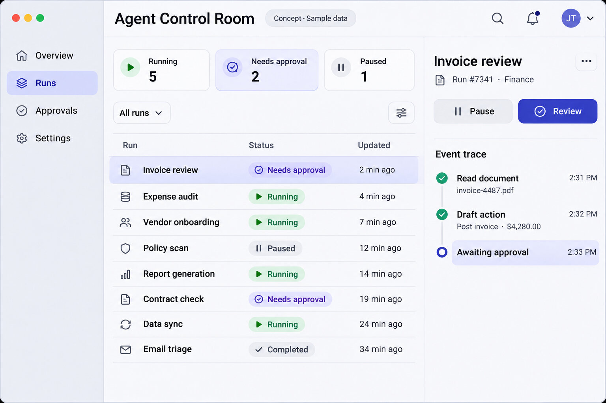
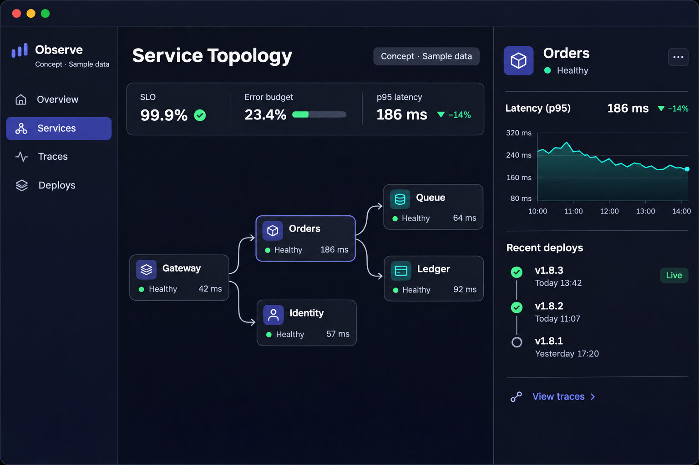
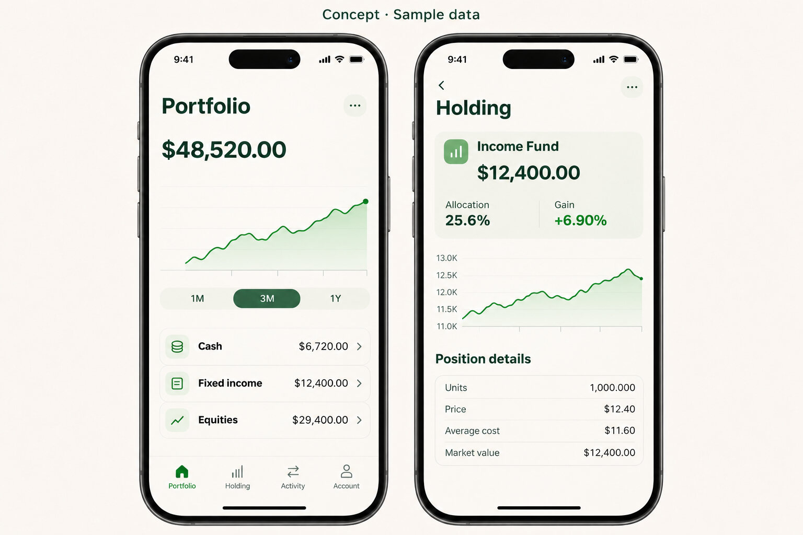
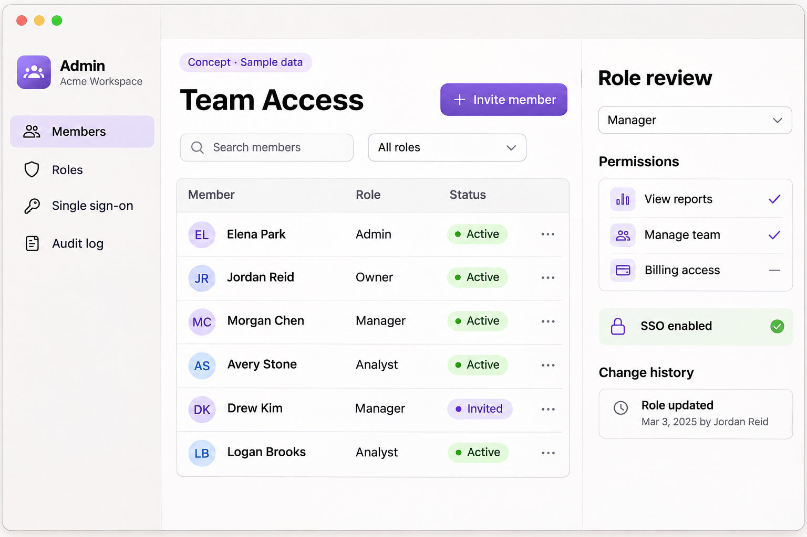
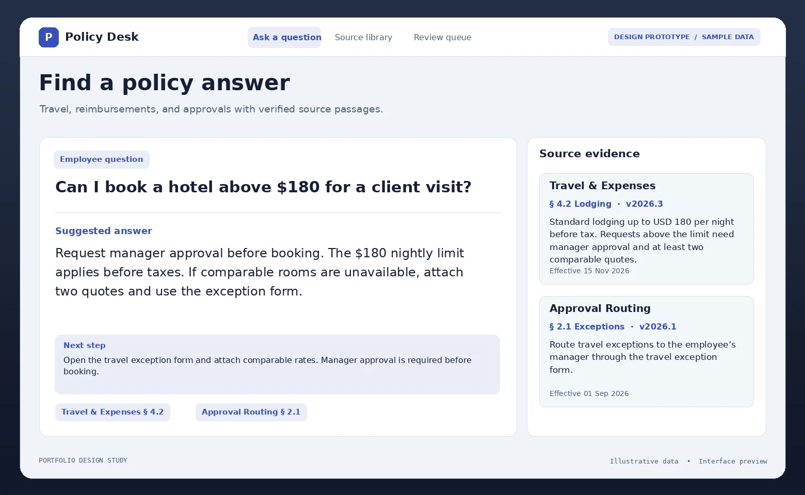
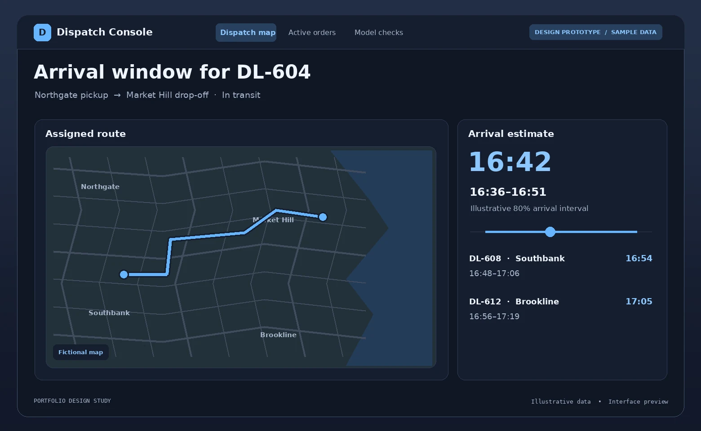
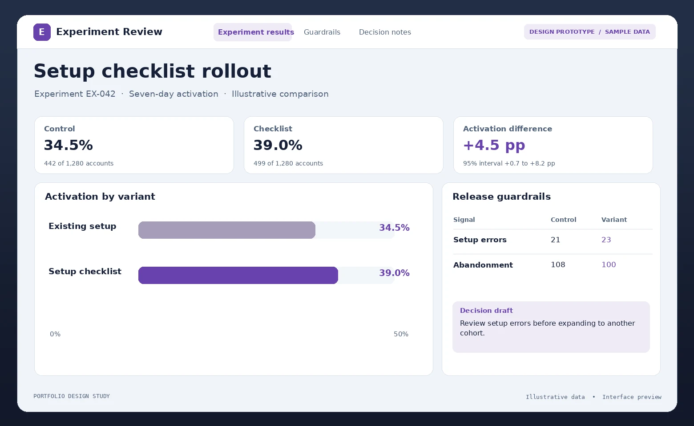

# AI, machine learning, and data science project briefs

Explore 12 interface prototypes with synthetic sample data. Each project brief explains the proposed workflow, intended data, evaluation, and first deliverable.

## Interface concepts

Explore four original interface mockups with fictional workflow states and sample data.

| Agent supervision | Distributed-systems observability |
| --- | --- |
|  |  |
| [Agent Control Room](interface-concepts/agent-control-room.md) | [Service Topology](interface-concepts/distributed-systems.md) |

| Investment portfolio | User access management |
| --- | --- |
|  |  |
| [Investment Portfolio](interface-concepts/investment-portfolio.md) | [Team Access](interface-concepts/user-access.md) |

## AI systems

| Project | Proposed deliverable | Prototype | Sample data |
| --- | --- | --- | --- |
| [Policy and Procedure Q&A](ai/policy-qa.md) | A policy assistant that cites the applicable passage and version, respects document permissions, and routes exceptions to staff. | [View](prototypes/policy-qa.webp) | [JSON](prototypes/policy-qa.json) |
| [Visual Inspection for Returns](ai/visual-inspection.md) | A photo review workspace that flags missing views, highlights potential damage, and records reviewer decisions. | [View](prototypes/visual-inspection.webp) | [JSON](prototypes/visual-inspection.json) |
| [Incident Triage Copilot](ai/incident-triage.md) | An evidence timeline connecting alerts, deployments, and runbooks for an on-call engineer. | [View](prototypes/incident-triage.webp) | [JSON](prototypes/incident-triage.json) |
| [Multilingual Voice Intake](ai/voice-intake.md) | An editable support request with timestamped evidence from English, Urdu, and mixed-language conversations. | [View](prototypes/voice-intake.webp) | [JSON](prototypes/voice-intake.json) |

## Machine learning

| Project | Proposed deliverable | Prototype | Sample data |
| --- | --- | --- | --- |
| [Delivery ETA with Prediction Intervals](ml/delivery-eta.md) | A dispatch view with an estimated arrival window and a time-ordered evaluation of interval coverage. | [View](prototypes/delivery-eta.webp) | [JSON](prototypes/delivery-eta.json) |
| [Nearby Offers Recommender](ml/nearby-offers.md) | A proximity and relevance ranker evaluated for eligibility, offer quality, and users with sparse histories. | [View](prototypes/nearby-offers.webp) | [JSON](prototypes/nearby-offers.json) |
| [Inventory Demand Forecasting](ml/inventory-forecast.md) | A rolling sales backtest and a reorder worksheet that shows forecast ranges and stockout assumptions. | [View](prototypes/inventory-forecast.webp) | [JSON](prototypes/inventory-forecast.json) |
| [On-Device Content Classification](ml/edge-classification.md) | An offline article classifier with a benchmark for accuracy, memory, latency, and abstention. | [View](prototypes/edge-classification.webp) | [JSON](prototypes/edge-classification.json) |

## Data science

| Project | Proposed deliverable | Prototype | Sample data |
| --- | --- | --- | --- |
| [Feature Rollout Experiment](data-science/rollout-experiment.md) | A launch memo covering activation lift, uncertainty, and release guardrails. | [View](prototypes/rollout-experiment.webp) | [JSON](prototypes/rollout-experiment.json) |
| [Subscription Cohort and Revenue Analysis](data-science/subscription-cohorts.md) | A tenure-aligned retention table and a reconciled recurring-revenue bridge. | [View](prototypes/subscription-cohorts.webp) | [JSON](prototypes/subscription-cohorts.json) |
| [Transit Accessibility Analysis](data-science/mobility-access.md) | An accessibility map and comparison of timetable changes for trips to clinics. | [View](prototypes/mobility-access.webp) | [JSON](prototypes/mobility-access.json) |
| [Marketplace Liquidity Analysis](data-science/marketplace-liquidity.md) | A zone-by-hour funnel that traces provider availability, responses, and completed bookings. | [View](prototypes/marketplace-liquidity.webp) | [JSON](prototypes/marketplace-liquidity.json) |

[Back to the portfolio](../../README.md)
