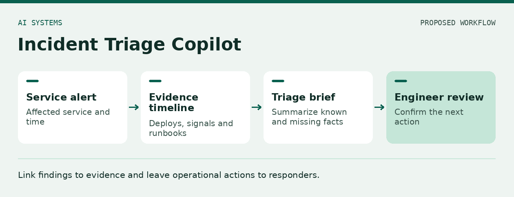

# Incident Triage Copilot

**Project brief · Proposed**

When checkout latency spikes during an on-call shift, responders need to identify which services and customers are affected. This copilot would assemble the evidence into a timeline and suggest where the responder should start looking.

## Data and provenance

Create a fictional storefront and generate timestamped alerts, service metrics, application logs, and release events. Each scenario would have an authored incident timeline, expected responding team, and synthetic runbook. Include duplicate alerts, delayed telemetry, routine deployments, and scenarios with incomplete evidence. Use generated identifiers and fixed random seeds so reviewers can reproduce each case.

## Proposed approach

Group alerts by service, environment, and time window, then attach nearby releases and observable changes in error rate, traffic, or latency. Retrieve the relevant runbook and generate a short triage note that links each observed fact to an event. Show uncertainty when the data supports several explanations. Responders would confirm incident severity, routing, and next actions. The prototype would accept read-only event inputs.

## Evaluation

Hold out entire incident scenarios so alert variants from one scenario stay together. Compare a threshold-only baseline and the copilot on alert grouping, routing accuracy, and how often a reported fact can be verified from its links. Time reviewers as they identify the affected service in each interface. Count false escalations on routine activity and check whether sparse data triggers review.

## First deliverable

A deterministic replay of scripted incidents, a browser view linking each triage note to evidence, and a labeled evaluation worksheet for reviewers.
