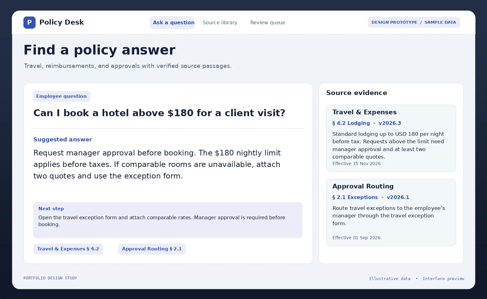

# Policy and Procedure Q&A

**Design prototype · Synthetic data**

An internal help desk loses time answering routine questions about travel approvals, purchase limits, and reimbursements. A policy assistant would point staff to the relevant rule and its effective date, then route exceptions to the policy owner.

Employee asks about an over-limit hotel booking and sees two current source passages.

[Full-size prototype](../prototypes/policy-qa.webp) · [Sample data](../prototypes/policy-qa.json) · [Workflow diagram](../figures/policy-qa.png)

## Data and provenance

Start with an original handbook for a fictional organization. Create dated editions, section IDs, and an owner for each policy. Write deliberate edge cases, including different rules by location, a policy that supersedes an older edition, and a procedure referenced by two policies. Store each document's source, approval status, effective date, and access group alongside the text.

## Proposed approach

Index the handbook by section and combine keyword and semantic retrieval. Constrain retrieval by the reader's access group, location, and applicable date before ranking passages and assembling a response. Each answer would cite the document title, section, and version and show the passage used. When sources conflict, an important fact is missing, or matches are weak, the assistant would ask for clarification or refer the question to the policy owner. Approval decisions stay with staff.

## Evaluation

Create a held-out set covering routine lookups, paraphrases, prior dates, conflicting rules, and requests for restricted material. Have a reviewer label the expected section, version, and escalation outcome. Compare cited-answer accuracy and correct escalations against keyword search. Test that changing a reader's access group removes restricted passages from results and citations.

## First deliverable

A searchable synthetic handbook, a browser prototype with expandable citations, and a repeatable evaluation set with reviewer labels.
