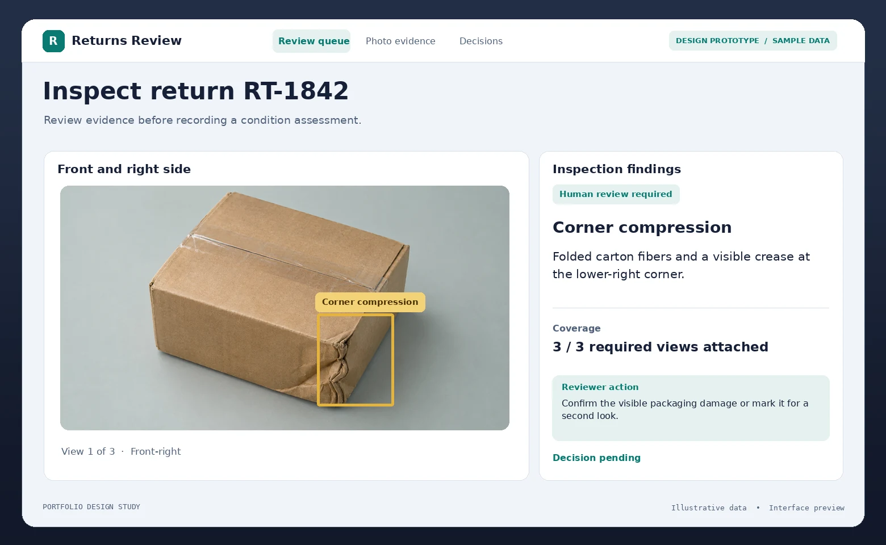

# Visual Inspection for Returns

**Design prototype · Synthetic data**

Returns reviewers often get several photos per item with inconsistent lighting and coverage. This proposal explores whether a review tool could identify visible damage and save reviewers time by pointing them to the image and region that merit attention.

Reviewer inspects a staged damaged parcel and confirms the observation.

[Full-size prototype](../prototypes/visual-inspection.webp) · [Sample data](../prototypes/visual-inspection.json) · [Workflow diagram](../figures/visual-inspection.png)

[Run the local review workspace and inspect its source](../../../projects/visual-inspection/).

## Data and provenance

Start with an original photo set of staged returns using unbranded sample items. Photograph intact items, crushed boxes, broken seals, and cosmetic scratches under varied lighting and camera angles. Record which item, session, and capture conditions produced each image. Two reviewers would label defect type and visible location independently. Keep disagreements as examples of uncertainty and remove shipment labels or identifying details before indexing images.

## Proposed workflow

Check each submission for blur and required views. A vision model would propose a defect category and show its supporting region alongside the original photo. A review queue would surface missing views, low-confidence predictions, and disagreement between images of the same item. Reviewers would confirm or correct proposed observations and make the final return decision.

## Evaluation

Hold out physical items and photo sessions to avoid testing on near duplicates. Compare the model with a checklist-only workflow. Measure missed visible damage, false flags on intact goods, and reviewer time per case. Report results separately by defect type and photo quality, and examine how accuracy changes as more cases are routed for manual review.

## First deliverable

A local review prototype with a labeled sample batch, a side-by-side photo and evidence view, and a rubric for comparing decisions on held-out returns.
