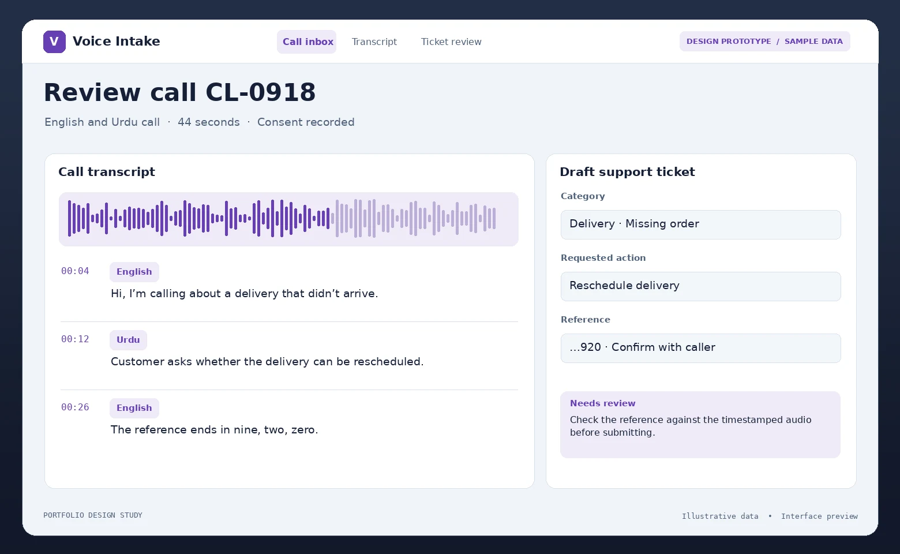

# Multilingual Voice Intake

**Design prototype · Synthetic data**

People opening a support request by voice may switch languages mid-sentence or spell a reference number over a noisy connection. This proposal explores turning those recordings into editable ticket drafts while preserving the original request and surfacing uncertain details.

A bilingual sample call becomes an editable delivery support ticket.

[Full-size prototype](../prototypes/voice-intake.webp) · [Sample data](../prototypes/voice-intake.json) · [Workflow diagram](../figures/voice-intake.png)

## Data and provenance

Write fictional support scenarios in English and Urdu, including mixed-language calls. Record the scripts with consenting speakers and log language, recording conditions, and permission to use each clip. Use invented names, contact details, and reference numbers. Pair each recording with a reviewed transcript and a manually labeled ticket so speech and field extraction can be evaluated separately.

## Proposed workflow

Transcribe the recording with timestamps, then extract a short description, request category, callback preference, and any reference number into a draft. Keep the original transcript next to the structured fields and link each field to its evidence in the conversation. Flag ambiguous language, missing required fields, and uncertain names or numbers for review. A reviewer can replay the relevant audio, correct the draft, and approve it before submission.

## Evaluation

Hold out speakers and scripts, and report results by language, code-switching, and background noise. Measure transcription error alongside field accuracy, with exact matching for reference numbers. Track how often the reviewer catches an incorrect field and how long it takes to prepare a ticket compared with manual intake.

## First deliverable

A local intake prototype with staged recordings, timestamped transcript and draft review, and a benchmark set for English, Urdu, and mixed-language clips.
