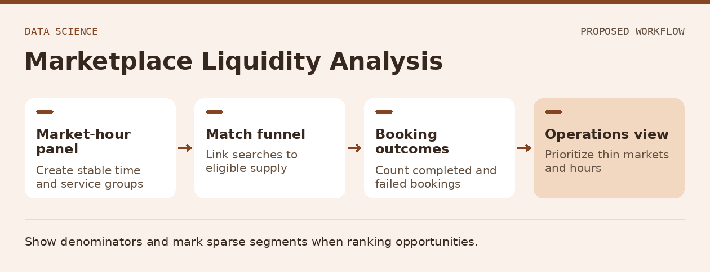

# Marketplace Liquidity Analysis

**Project brief · Proposed**

Identify whether a local services marketplace should recruit more providers, change how it matches requests, or improve booking follow-through. The proposed study focuses on one service category across three zones and looks for the point where viable requests stop converting.

## Data and measures

Create synthetic requests, provider schedules, eligibility rules, offers, responses, and bookings for the first demonstration. A real analysis would need approved event exports with pseudonymous request and provider IDs, coarse zones, service categories, and timestamps. Measure provider availability from schedule snapshots recorded before each request. That preserves what the marketplace knew when it tried to make a match.

Use eligible requests as the main denominator. Deduplicate retries and identify rescheduled bookings using explicit event rules. For each zone and request hour, estimate the shares with an available qualified provider, a response from an eligible provider within 24 hours, and a completed booking within seven days. Separate customer cancellations from provider declines. Use time to first response and provider workload to check whether a faster process would concentrate work on a few providers.

## Validation and decision artifact

Reconcile event counts to bookings and inspect samples of requests with no match, multiple offers, or a cancellation. Exclude recent requests that cannot yet complete the measurement window. Compare weekdays with weekends, check sensitivity to zone boundaries and response windows, and suppress cells with too few requests. Treat observed differences as diagnostic evidence and test an intervention before attributing an improvement to it.

The first deliverable would be a zone-by-hour table with funnel counts and uncertainty. It would identify one constraint to test and a metric for judging the response.
