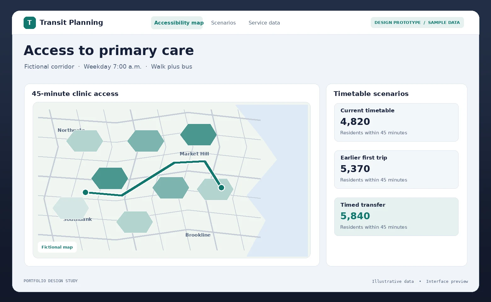

# Transit Accessibility Analysis

**Design prototype · Synthetic data**

Compare an earlier first-bus departure with a timed transfer for people traveling to primary care clinics. The decision is which timetable change warrants a pilot in a single corridor.

Planner compares change options against a synthetic baseline on a fictional transit corridor.

[Full-size prototype](../prototypes/mobility-access.webp) · [Sample data](../prototypes/mobility-access.json) · [Workflow diagram](../figures/mobility-access.png)

## Data and measures

Select one city with a publicly available General Transit Feed Specification schedule and a municipal clinic registry. Record each source, license, download date, and service calendar. Use open street-network data for walking access and published small-area population counts to weight origins. Represent origins as grid cells or census centroids with aggregate counts. Patient addresses and trip histories are outside the scope.

Build a baseline for weekday mornings that includes walking, initial wait, scheduled travel, and transfers. Measure the share of residents within a 45-minute trip to at least one clinic open at arrival. Compare the two scenarios at fixed departure times, such as every 15 minutes between 7 and 9 a.m. Report the population gaining or losing access and the change in vehicle service minutes for each scenario.

## Validation and decision artifact

Check a sample of baseline trips against published timetables, including a missed connection, a walking-only trip, and a route with no early service. Vary walking speed, transfer buffers, and departure times to see whether the preferred scenario changes. Distinguish scheduled reachability from real-world reliability. If historical delay data are available, use them to test how often the timed transfer would hold.

The first deliverable would be a paired accessibility map and a corridor-level table. It would highlight where each option helps, any areas losing service, and the operating assumptions planners would need to confirm before a pilot.
