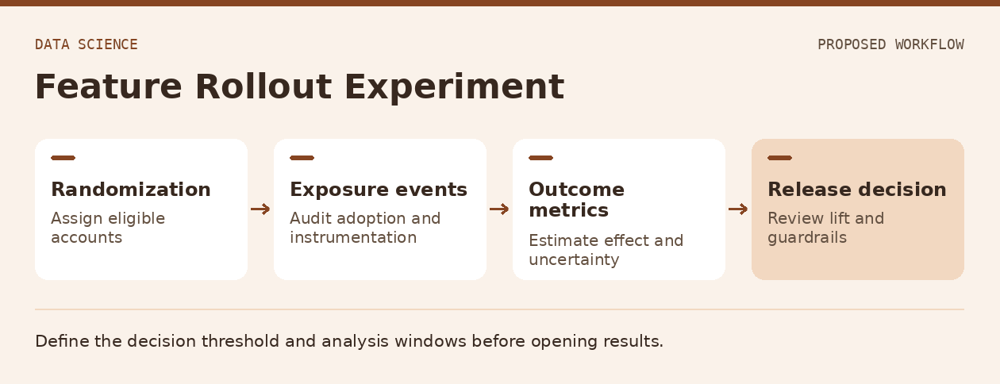

# Feature Rollout Experiment

**Project brief · Proposed**

Evaluate whether an optional setup checklist helps new accounts complete their first meaningful action within seven days. The decision is whether to release the checklist broadly, revise it, or leave the current setup flow in place.

## Data and design

Use generated event logs for a reproducible example. A real analysis would require authorized, pseudonymized account creation, random assignment, exposure, setup, and core-action events. Specify the core action and eligible account population before enrollment. Record the assignment timestamp and product version so retries and reassignments can be detected. Exclude internal and test accounts using rules set before randomization.

Assign eligible accounts equally to the current flow and the checklist. Keep the assignment stable for each account. Estimate the seven-day activation difference across all assigned accounts, including those that never see the checklist. Define the smallest worthwhile lift and the stopping rule before looking at outcomes. Monitor setup abandonment and error rates as guardrails.

## Validation and decision artifact

Check the assignment split, event ordering, unique exposure counts, and completeness of follow-up. Investigate missing events or account-level contamination before interpreting outcomes. Show confidence intervals and check whether conclusions change under plausible missing-event assumptions. Treat platform and acquisition-channel breakdowns as exploratory unless they were specified and powered in advance.

The first deliverable would be a one-page launch memo with the activation estimate, uncertainty, guardrails, and a decision rule. A broad rollout would require evidence of a worthwhile lift and acceptable guardrail performance. Inconclusive evidence would call for another test or a revised checklist.
