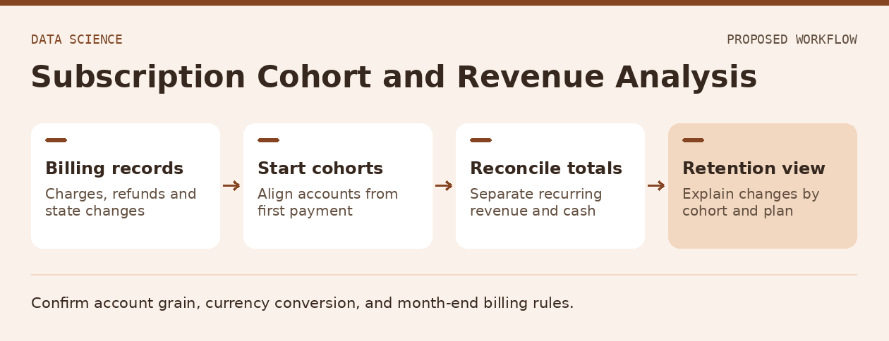

# Subscription Cohort and Revenue Analysis

**Project brief · Proposed**

Determine whether a subscription business should prioritize onboarding improvements or failed-payment recovery. The first analysis would locate where paying subscribers leave and how those losses contribute to changes in recurring revenue.

## Data and measures

Start with a generated billing dataset spanning 18 monthly cohorts and two plan intervals. For a real study, use a permissioned billing export with pseudonymous customer IDs, invoices, plan changes, cancellation reasons, payment attempts, refunds, and reactivations. Use one reporting currency or document conversion rates. Preserve both event time and ingestion time so late events can be reconciled.

Group subscribers by first successful paid invoice. Calculate retention at each completed month of tenure, with a separate view for account and recurring-revenue retention. Convert annual plans to monthly equivalents for recurring revenue while keeping cash receipts separate. Build a monthly revenue bridge for new subscriptions, upgrades, downgrades, churn, and reactivation. Separate voluntary cancellations from terminal payment failures and leave ambiguous cases in an unknown category.

## Validation and decision artifact

Reconcile revenue totals to the export, then review representative accounts with pauses, mid-cycle changes, refunds, or duplicate events. Mark cohorts without enough follow-up. Compare like-for-like tenure across plan intervals and rerun the analysis with an alternative payment grace period to test whether the prioritization changes. Use customer-level uncertainty estimates where cohort sizes allow.

The first deliverable would be an annotated cohort table and revenue bridge with revenue lost after unresolved payment failures shown separately from early voluntary churn. The review would choose one intervention to test and define the metric that would justify expanding it.
