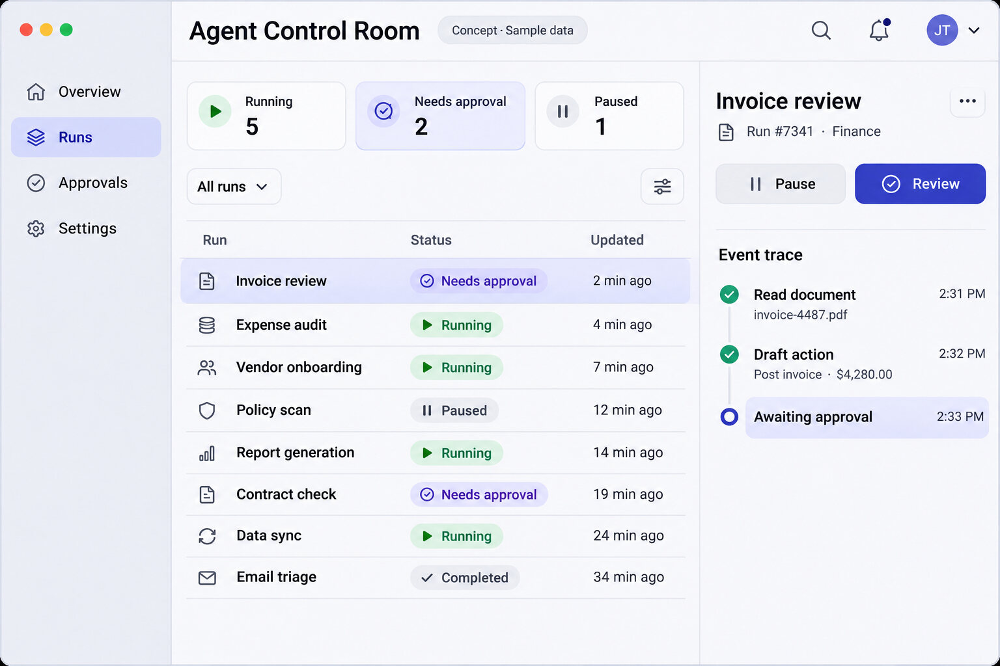

# Agent Control Room

**Interface concept · Proposed**

An operations reviewer would select a run in the Mac dashboard and see its current step, owner, and execution status. The approval queue would surface runs waiting on a person. Selecting one would bring the proposed action, its destination, and the relevant evidence into the run detail.

The event trace would show what the agent read, which tools it called, and where it paused. Pending, running, paused, and completed steps would have distinct text states. A reviewer could pause a run or approve the specific pending action from the detail view.

Approval would apply only to the displayed action and parameters. Changes to either would require fresh approval. The event trace would record the reviewer’s decision and timestamp. All run records shown in the mockup are synthetic.
