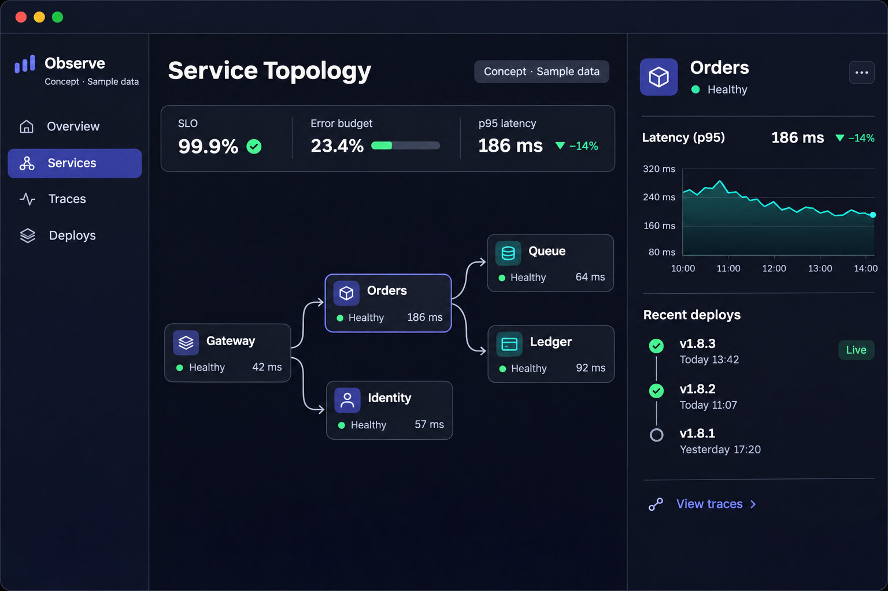

# Distributed Systems Dashboard

**Interface concept · Proposed**

An on-call engineer would start with the service topology and select a node to see its dependencies, latency, and error rate in the selected time window. The SLO panel would pair the reliability target with the error budget remaining, giving context for a change in service health.

Deploy events would share a timeline with latency and errors. Selecting a deploy would narrow the window around the release. The engineer could drill into a representative trace to see which service or dependency contributed to a slow request.

This would be a read-only console. Missing or delayed telemetry would be marked explicitly in the affected panel, and traces would omit sampled payload content. A nearby deploy would be shown as evidence to investigate. The topology and telemetry in the mockup are synthetic.
