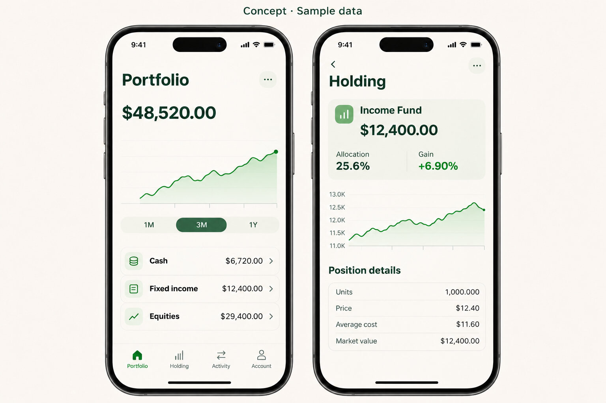

# Investment Portfolio

**Interface concept · Proposed**

The iPhone home screen would show the sample portfolio’s USD value above a performance chart. Available cash and invested value would appear separately, with an allocation breakdown to make concentration visible. Changing the chart range would update the dates and return period together.

Tapping a holding would open its detail, with the position’s value, cost basis, portfolio share, and recent performance. The user could compare an overall gain with the gains or losses on individual holdings and return to the same portfolio view.

A loss would carry a minus sign and a written label so its meaning survives a change in color perception. The chart’s end date and valuation timestamp would stay visible. All prices, returns, and cash balances are simulated. This concept covers viewing and reviewing a portfolio.
