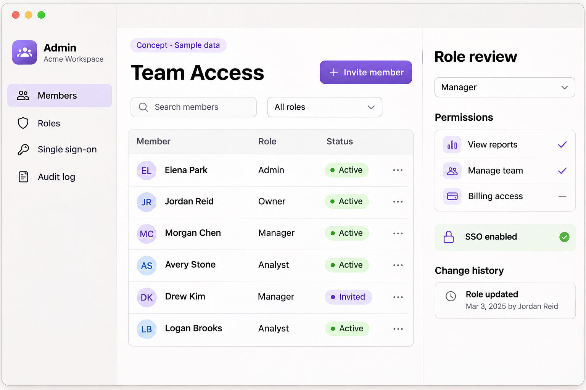

# User Access Dashboard

**Interface concept · Proposed**

A workspace administrator would use the Mac dashboard to find a team member, check their role and access status, and open their recent access history. The dashboard would show which users authenticate through SSO, whether the provider is connected, and which invitations are still pending.

To invite a colleague, the administrator would select a role and scope. A review step would show the effective permissions before the invitation is sent. For an existing member, the same view would show what changes when their role is edited, including any newly granted admin privileges.

Access updates would require explicit confirmation. The audit panel would record the actor, affected account, old and new roles, and timestamp. Reviewers with read-only privileges could inspect the history. The accounts and identity-provider states in the mockup are fictional.
