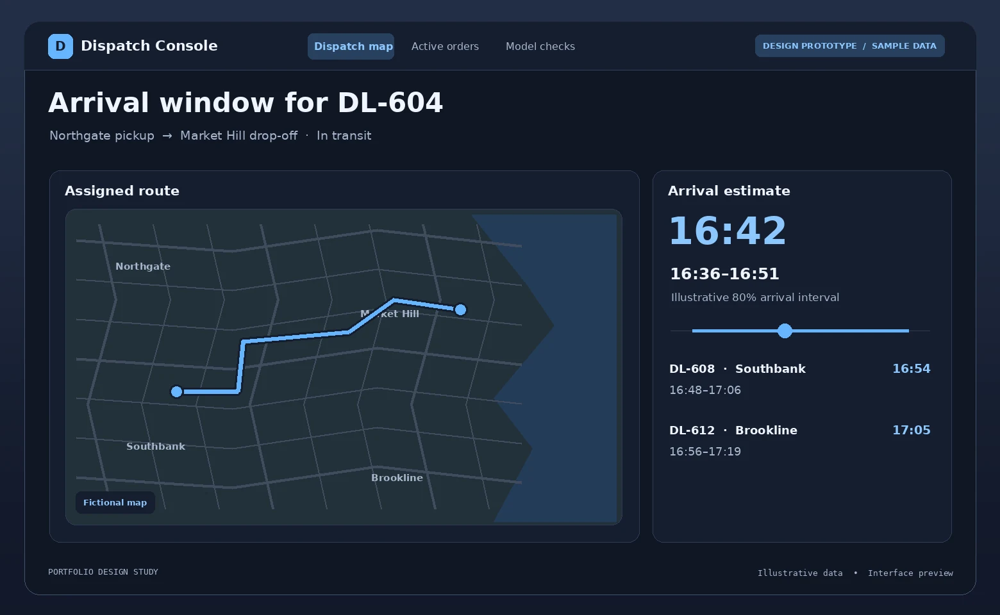

# Delivery ETA with Prediction Intervals

**Design prototype · Synthetic data**

A dispatch team needs to know when a delivery is likely to arrive and how much room to leave for delays. This project would estimate delivery time at assignment and show an interval that helps operators decide when to follow up.

Dispatcher checks an illustrative arrival window before following up on an active delivery.

[Full-size prototype](../prototypes/delivery-eta.webp) · [Sample data](../prototypes/delivery-eta.json) · [Workflow diagram](../figures/delivery-eta.png)

## Data and provenance

Generate synthetic delivery assignments across several fictional zones. Each record would include the assignment timestamp, origin and destination zones, estimated route length, and the number of active deliveries at assignment. Simulate arrival times with separate travel and handoff delays, including busier periods and occasional disruptions. Document the generator version, random seeds, feature availability, and label definition. Keep the realized travel and handoff times for evaluation and error analysis.

## Proposed approach

Start with historical median delivery time by distance band and hour, backed by the overall median for sparse groups. Use empirical lower and upper quantiles for the baseline interval. Compare it with gradient-boosted quantile regressors that predict the median and the bounds of an 80% interval. Use a later calibration window to adjust the bounds with split conformal calibration.

## Evaluation

Train, calibrate, and test on consecutive time blocks. Build each feature using records available at the assignment timestamp. Compare median absolute error, interval coverage, and average width against the baseline. Break out results by route length and peak load, and report how often the lower or upper bound misses. Use a final disruption scenario to check how the interval behaves when conditions shift.

## First deliverable

A versioned synthetic dataset, a reproducible evaluation, and a small dispatch view showing the estimated arrival, interval, and assignment-time inputs.
