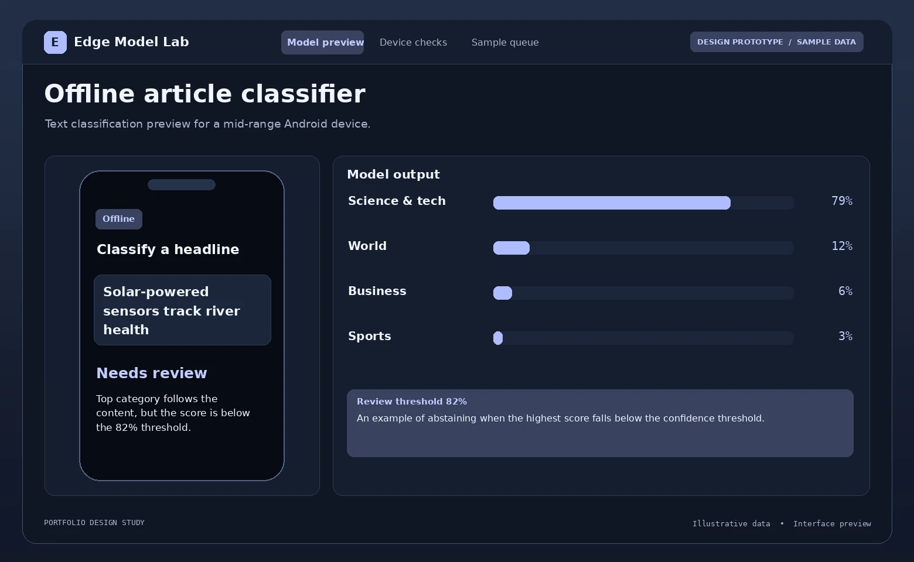

# On-Device Content Classification

**Design prototype · Synthetic data**

A mobile reading app needs a topic label for short English articles so readers can filter saved items offline. The first version would classify a title and short description as world news, sports, business, or science and technology, with an option to leave uncertain items unclassified.

An offline example defers a headline for review when no category exceeds the confidence threshold.

[Full-size prototype](../prototypes/edge-classification.webp) · [Sample data](../prototypes/edge-classification.json) · [Workflow diagram](../figures/edge-classification.png)

## Data and provenance

Use the public AG News classification dataset, which provides labeled headlines and descriptions across four topics. Record the dataset revision and normalization rules. Add a separate synthetic challenge set with short titles, missing descriptions, spelling mistakes, and topics outside the four supported classes. Preserve its generation rules and label guidelines so the evaluation can be repeated. [AG News dataset card](https://huggingface.co/datasets/fancyzhx/ag_news)

## Proposed approach

Start with a word and character n-gram logistic regression baseline. Compare it with a small text convolutional model converted to an integer-quantized mobile format. Package the tokenizer and model together, set a fixed input limit, and tune an abstention threshold on validation data. The proposed app would run inference locally and let the reader change a suggested label.

## Evaluation

Keep the official test split held out. Apply a fixed text similarity rule to remove training articles that duplicate test articles, then fit preprocessing and model parameters on training data. Report macro F1, per-topic recall, errors among accepted predictions, and the fraction classified at the chosen threshold. On a reference Android phone, record the device model, package size, peak memory, and cold and warm end-to-end latency. Report challenge set behavior separately.

## First deliverable

An offline evaluation report, a device benchmark plan, and a prototype screen showing the predicted topic and manual override.
