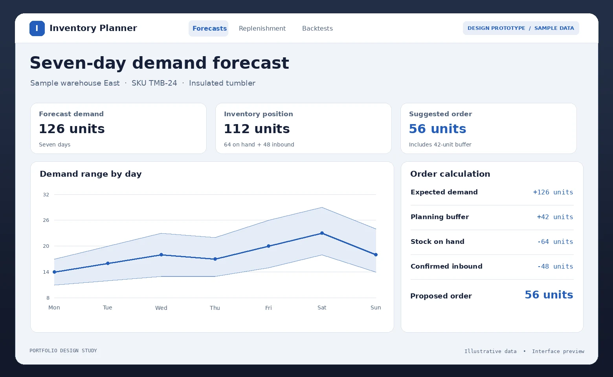

# Inventory Demand Forecasting

**Design prototype · Synthetic data**

A small retailer needs a short list of products to reorder before the next delivery. This project would produce seven-day sales forecasts and show where uncertainty can change a replenishment decision.

Planner compares a synthetic demand range with stock, inbound orders, and buffer stock.

[Full-size prototype](../prototypes/inventory-forecast.webp) · [Sample data](../prototypes/inventory-forecast.json) · [Workflow diagram](../figures/inventory-forecast.png)

## Data and provenance

Use a documented slice of the public M5 Forecasting data. Select about 30 item-store series using a minimum history requirement from the first training window. Use daily unit sales and calendar attributes. Treat the target as observed sales, which can be lower than demand during stockouts. Use a separate synthetic inventory scenario with known on-hand quantities, restock dates, and lead times to explore that difference. [M5 data](https://www.kaggle.com/competitions/m5-forecasting-accuracy/data)

## Proposed approach

Establish a seasonal baseline by repeating the previous week's sales. Compare it with a pooled gradient-boosted model that estimates median and upper-quantile sales for the full seven-day horizon. Use lagged sales, prior rolling summaries, item identifiers, and known calendar events. Apply an explicit lead-time assumption when translating a forecast and current stock into a proposed reorder quantity.

## Evaluation

Use rolling weekly cutoffs, training on targets whose entire seven-day window ends before each cutoff. Rebuild history features for each forecast. Report mean absolute error on weekly totals, upper-quantile loss, and coverage across fast- and slow-selling items. In the synthetic reorder simulation, compare unfilled units and average stock under the same lead-time and ordering policy.

## First deliverable

A repeatable backtest, a forecast table with error and coverage by item segment, and an illustrative reorder list for the synthetic inventory scenario.
