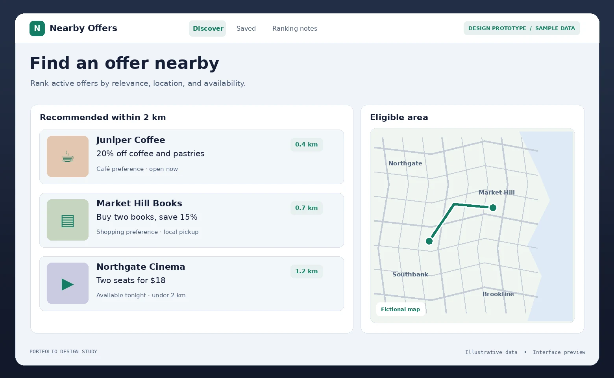

# Nearby Offers Recommender

**Design prototype · Synthetic data**

A neighborhood offers app needs to surface promotions people can actually use. The first version would rank active offers within a chosen radius and balance proximity with relevance, including for someone who has just opened the app.

Three eligible offers are ranked for a fictional visitor with a two-kilometer radius.

[Full-size prototype](../prototypes/nearby-offers.webp) · [Sample data](../prototypes/nearby-offers.json) · [Workflow diagram](../figures/nearby-offers.png)

## Data and provenance

Create a synthetic catalog of venues, locations, categories, discounts, opening hours, and offer validity periods. Generate fictional sessions that contain a coarse location, optional category preference, and prior interactions. A separate simulator would generate clicks and saves from hidden preferences, convenience, and random variation. Log impressions and their order, and publish the generation rules, seeds, and offer snapshots used in evaluation.

## Proposed approach

Filter by distance, availability, and any user-selected category before ranking. Start with a distance-first baseline, breaking ties by offer expiry. Compare it with a lightweight ranker using distance, category match, offer value, and prior category interactions. For sessions with no history, fall back to contextual features and record the reason for each top recommendation.

## Evaluation

Split sessions chronologically and reconstruct offer eligibility at the exact request time. Compute interaction counts using earlier events only. Use randomized impressions in the synthetic test set to reduce position bias. Report NDCG@5 and Recall@5 on judged candidates, show results for new and returning users separately, and check that expired or out-of-radius offers never appear. Report category coverage alongside ranking quality.

## First deliverable

A generated offer catalog, a reproducible comparison against the distance baseline, and a browser mock-up that shows how changing location or category affects eligible offers.
