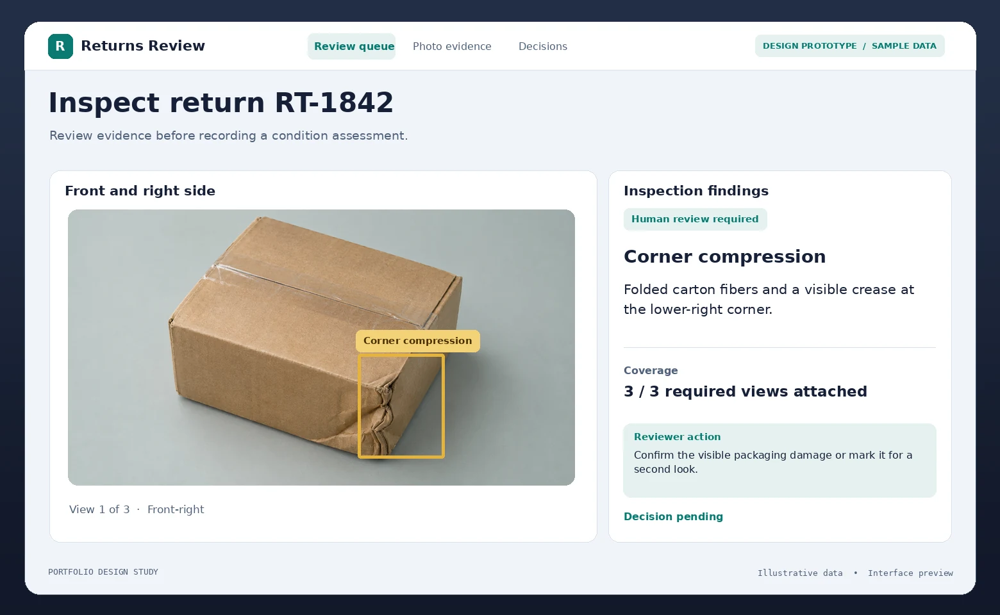

# Visual Inspection for Returns

A runnable local workspace for reviewing return photos. Open the included parcel sample, add an item with up to three views, inspect the evidence, and record a human review in SQLite. An optional OpenAI adapter suggests visible findings and approximate evidence areas for uploaded photos.



## Run locally

Use Python 3.11 or newer. From `projects/visual-inspection`:

```sh
python -m venv .venv
source .venv/bin/activate
python -m pip install -r requirements.txt
cp .env.example .env
python -m returns_review
```

Open [http://127.0.0.1:8000](http://127.0.0.1:8000). On Windows PowerShell, use `.venv\Scripts\Activate.ps1` and `Copy-Item .env.example .env`.

You can explore the seeded sample and review uploads manually with the default settings. For vision analysis, put your API key in `OPENAI_API_KEY` in your local `.env`, restart, and choose **Analyze photos** on an uploaded return. The sample shows a prewritten illustrative finding. Uploaded photos are sent to OpenAI when you select **Analyze photos**. Use photos you can share with the configured provider. The final decision is recorded by a reviewer.

| Variable | Default | Purpose |
| --- | --- | --- |
| `OPENAI_API_KEY` | Empty | Enables optional vision analysis |
| `OPENAI_MODEL` | `gpt-4.1-mini` | Vision-capable Responses API model with structured outputs |
| `APP_PORT` | `8000` | Port for the local server |
| `RETURNS_DB_PATH` | `.data/returns.sqlite3` | SQLite data file, relative to this project or an absolute path |
| `APP_SECRET_KEY` | Generated at startup | Set a private random value to retain form sessions across restarts |

Shell variables take precedence over `.env`. Keep your local `.env` private. The server listens on the loopback address and is designed for a local demo.

## Architecture

| Module | Responsibility |
| --- | --- |
| [`app.py`](returns_review/app.py) | Form validation, upload, observation review, and server-rendered pages |
| [`images.py`](returns_review/images.py) | Validate and normalize images before storing or analyzing them |
| [`models.py`](returns_review/models.py) | Structured observations and normalized evidence locations |
| [`vision.py`](returns_review/vision.py) | OpenAI adapter with a bounded request and validated response |
| [`store.py`](returns_review/store.py) | Atomic SQLite writes for cases, photos, analysis, and review decisions |
| [`config.py`](returns_review/config.py) | Load project-local configuration |

Photos and return records commit together. Analysis is a separate action, so a provider failure leaves the photos available for manual review. An analysis lease prevents overlapping requests for the same return. Review results remain authoritative if an analysis finishes later.

## Verify locally

```sh
python -m unittest -v
```

The tests exercise sample loading, upload validation, review persistence, and the analysis path with a simulated provider.
